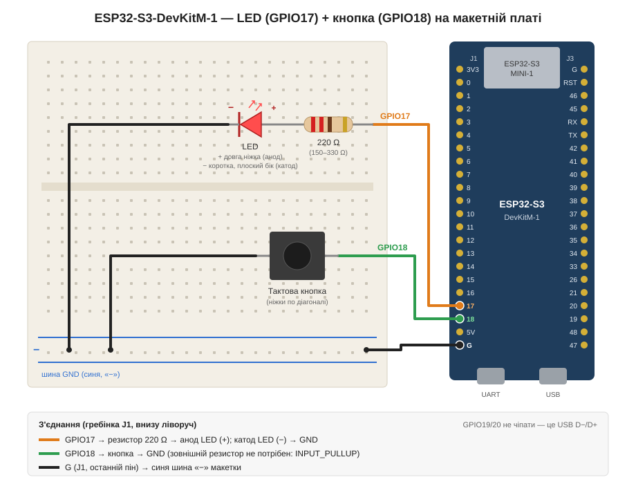

# Модуль 2.1 — Embedded C++ на ESP32-S3

Неблокуючий blink, constexpr-конфігурація, кнопка на перериванні з
антидребезгом у superloop і вимірювання часу ітерації `loop()`.

## Схема підключення



| Компонент | Підключення |
|---|---|
| LED (через резистор 220 Ω) | GPIO17 → резистор → анод (довга ніжка); катод → GND |
| Тактова кнопка | GPIO18 → кнопка → GND (внутрішній `INPUT_PULLUP`, резистор не потрібен) |
| GND плати (G, останній пін J1) | синя шина «−» макетної плати |

Плата: ESP32-S3-DevKitM-1. GPIO17 і GPIO18 стоять поруч із GND унизу
гребінки J1. Це звичайні виводи: не strapping (на S3 це GPIO0, 3, 45, 46)
і не USB (GPIO19/20 — це USB D−/D+, їх чіпати не можна, інакше зникне Serial).

> На макетці кнопку ставлять **поперек центральної канавки**. Пари ніжок,
> що лежать з одного боку, зазвичай з'єднані між собою, тому під'єднуйте
> GPIO і GND до ніжок по діагоналі.

## Структура

```
include/
  config.h         — усі constexpr-параметри (піни, інтервали, швидкість Serial)
  led.h            — enum class LedState, клас Led { init(), set(), toggle() }
  button.h         — кнопка: ISR ставить volatile-прапорець, антидребезг у poll()
  loop_profiler.h  — середній / мін / макс час ітерації loop()
src/
  button.cpp       — ISR (IRAM_ATTR) та визначення volatile-прапорця
  main.cpp         — App: superloop, режими LED (enum class LedMode)
```

## Як виконані вимоги

| Вимога | Де |
|---|---|
| `enum class` для стану LED | `LedState { Off, On }` у [led.h](include/led.h), `LedMode` у [main.cpp](src/main.cpp) |
| `constexpr` для піна й інтервалу | `config::Led::kPin`, `config::Led::kBlinkIntervalMs` у [config.h](include/config.h) |
| Без `delay()`, неблокуючий superloop | `App::updateLed()` порівнює `millis()` з моментом останнього перемикання |
| Клас `Led` з `init()` і `set(LedState)` | [led.h](include/led.h) |
| Конфігурація через `static constexpr`, без магічних чисел | структури `config::Led`, `config::Button`, `config::SerialPort`, `config::Profiler` |
| Мінімум глобальних змінних | увесь стан у класі `App`. Глобальні лише `app` (в анонімному namespace, бо Arduino викликає вільні `setup()`/`loop()`) і `volatile bool` для ISR |
| Без heap і STL-контейнерів | немає `new`, `malloc`, `std::vector`, `String`. Усі об'єкти статичні |
| Вимірювання часу `loop()` | `LoopProfiler`: звіт у Serial кожні 1000 ітерацій. Час друку в замір не входить |
| Кнопка на перериванні | `attachInterrupt(..., FALLING)`. ISR лише ставить `volatile bool` |
| Режими Blink → On → Off → Blink | `nextMode()` + `static_assert` перевіряє цикл режимів під час компіляції |
| Антидребезг у `loop()` | state machine `Idle → Debouncing → WaitRelease` у `Button::poll()`, без блокувань |

## Збірка та прошивка (PlatformIO)

```bash
pio run
```

```bash
pio run -t upload
```

```bash
pio device monitor
```

Результат збірки (Arduino-ESP32, `esp32-s3-devkitm-1`):

```
RAM:   [=         ]   5.9% (used 19328 bytes from 327680 bytes)
Flash: [=         ]   7.9% (used 263505 bytes from 3342336 bytes)
```

> **Arduino IDE:** створіть скетч, перейменуйте `src/main.cpp` на `<назва_скетчу>.ino`,
> а `button.cpp` і всі файли з `include/` покладіть поруч в ту саму папку.

## Результат виконання

Вивід Serial Monitor (115200 бод). Сюди вставте свій вивід з плати:

```
Started. Mode: Blink
[loop] 1000 iters: avg=... us, min=... us, max=... us
Button -> mode: AlwaysOn
Button -> mode: AlwaysOff
Button -> mode: Blink
```

<!-- Фото / відео зібраної схеми: docs/photo.jpg -->
